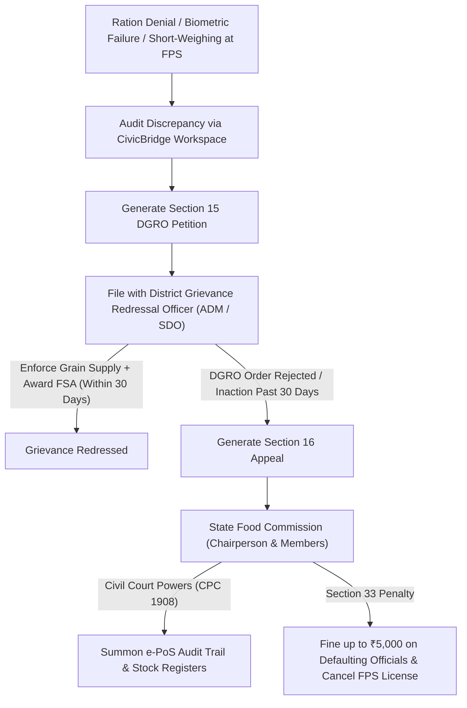

# National Food Security Act (NFSA 2013) Ration Entitlement, Biometric Failure & State Food Commission Workspace

## 1. Executive Summary & Statutory Foundation

The **National Food Security Act (NFSA 2013)** legally transformed the Targeted Public Distribution System (TPDS) in India from a discretionary welfare scheme into an enforceable statutory right to food. Under Section 3(1) of the Act, every eligible person belonging to Priority Households (PHH) and Antyodaya Anna Yojana (AAY) households is entitled to receive subsidized or free foodgrains from designated Fair Price Shops (FPS).

Despite statutory guarantees and Central Government schemes such as the Pradhan Mantri Garib Kalyan Anna Yojana (PMGKAY), millions of vulnerable citizens face acute exclusion at Fair Price Shops due to:
1. **Unlawful Biometric Denial**: Electronic Point of Sale (e-PoS) fingerprint scanners failing due to fingerprint attrition (common among agricultural laborers, construction workers, and senior citizens) with dealers turning beneficiaries away in direct violation of Supreme Court directives.
2. **Weighment Deficits & Arbitrary Deductions**: Illegal cuts in grain quantities (often 1 to 5 kg deducted per sack citing "tare/bag weight").
3. **Price Extortion**: Dealers demanding illegal transport or handling surcharges over statutory or zero-rupee PMGKAY allotments.
4. **Denial of Food Security Allowance**: Failure of State Governments to automatically disburse the statutory Food Security Allowance (FSA) under Section 8 when rations fail to reach distribution counters.

The **CivicBridge NFSA Ration Entitlement & Biometric Redressal Workspace** provides an offline-first, client-side toolkit enabling citizens, civil society advocates, and vigilance committees to audit monthly foodgrain allotments, calculate statutory compensation, and generate formal legal petitions for the **District Grievance Redressal Officer (DGRO)** under Section 15 and the **State Food Commission** under Section 16.

---

## 2. Statutory Entitlements & Pricing Architecture

### 2.1 Categorization Under Section 3 & Schedule I

| Card Category | Legal Provision | Statutory Quota | Statutory Central Issue Price (CIP) | PMGKAY Allocation |
| :--- | :--- | :--- | :--- | :--- |
| **Antyodaya Anna Yojana (AAY)** | Section 3(1) NFSA | **35 kg per household** per month | Rice: ₹3/kg, Wheat: ₹2/kg, Coarse grains: ₹1/kg | **100% Free** (₹0/kg) |
| **Priority Households (PHH)** | Section 3(1) NFSA | **5 kg per member** per month | Rice: ₹3/kg, Wheat: ₹2/kg, Coarse grains: ₹1/kg | **100% Free** (₹0/kg) |
| **General / Non-NFSA** | State TPDS Rules | 10 to 15 kg per household | State-determined subsidized prices | Subject to state rules |

### 2.2 Short-Weighing & Overcharging Audit

Under Clause 10 of the **Targeted Public Distribution System (Control) Order, 2015**, every Fair Price Shop licensee must maintain an electronic weighing scale linked or integrated with the e-PoS device.
- Deducting sack weight or short-weighing is a cognizable offence under Section 3 and Section 7 of the **Essential Commodities Act, 1955** and the **Legal Metrology Act, 2009**.
- Charging any fee above the Central Issue Price or charging any amount for free PMGKAY grains constitutes criminal extortion.

---

## 3. Biometric Exception Handling & Supreme Court Mandates

### 3.1 The Absolute Prohibition Against Denial of Food

In *Swaraj Abhiyan v. Union of India (2016)*, *Justice K.S. Puttaswamy (Aadhaar) v. Union of India (2018)*, and Central Ministry Circular No. 17-1/2017-Comp, the Supreme Court of India and the Ministry of Consumer Affairs, Food and Public Distribution held:

> *"No entitled citizen shall be denied their statutory foodgrain quota under the NFSA solely on grounds of biometric authentication failure, lack of Aadhaar linkage, iris scanner malfunction, or e-PoS device connectivity outage."*

### 3.2 Mandatory Statutory Fallback Protocols

When an e-PoS machine fails to authenticate a beneficiary, the FPS dealer is legally mandated to employ one of the following fallback mechanisms:
1. **Aadhaar-Registered Mobile OTP**: An OTP is triggered to the mobile number seeded with the ration cardholder's Aadhaar.
2. **Authorized Nominee / Proxy Biometric**: Senior citizens (above 65), bedridden persons, and persons with disabilities (PwD) are entitled to designate a family nominee or trusted neighbor to authenticate and collect the foodgrains on their behalf.
3. **Physical Manual Exemption Register**: The dealer must maintain a physical register noting the ration card number, quantity dispensed, beneficiary signature/thumb impression, and date. The transaction is subsequently verified by the local Village / Ward Vigilance Committee.

**Turning away a cardholder empty-handed because their fingerprint was rejected by an e-PoS machine is a direct statutory infraction.**

---

## 4. Section 8 Food Security Allowance (FSA)

Under Section 8 of the NFSA 2013 read with the **Food Security Allowance Rules, 2015**:
- If entitled foodgrains are not supplied to an eligible household within the prescribed statutory cycle (by the 3rd week of the subsequent calendar month), the beneficiary has a statutory right to receive **Food Security Allowance** from the State Government.
- **Formula**:
  $$\text{FSA Amount} = \text{Deficit Grain Quantity (kg)} \times \text{Minimum Support Price (MSP)}$$
- Where non-supply is prolonged, statutory interest and compensation multipliers apply.
- The District Grievance Redressal Officer (DGRO) has statutory power to order the State Food Department to credit this allowance directly into the beneficiary's bank account.

---

## 5. Two-Tier Grievance Redressal Mechanism

### 5.1 District Grievance Redressal Officer (Section 15)
- Presided over by an officer of Additional District Magistrate (ADM) or Sub-Divisional Officer (SDO) rank.
- Hears grievances relating to non-distribution of foodgrains, biometric failures, and overcharging.
- Orders release of grain, disburses Food Security Allowance, and initiates proceedings to suspend/cancel FPS licenses.

### 5.2 State Food Commission (Section 16)
- Independent quasi-judicial statutory body with powers of a Civil Court trying a suit under the Code of Civil Procedure, 1908.
- Hears appeals against DGRO orders within 30 days.
- Summons witnesses, orders production of e-PoS server transaction logs, and imposes penalties up to ₹5,000 on defaulting public servants under Section 33.

---

## 6. Client-Side Vault & Privacy Architecture

- **Local-Only Storage**: All dispute records are stored exclusively in the browser's `localStorage` under `civicbridge_nfsa_ration_vault` and `civicbridge_nfsa_ration_settings`.
- **Cryptographic Seal**: Every record is stamped with a deterministic SHA-256 digest (`generateIntegritySeal`) ensuring tamper evidence.
- **Digital Personal Data Protection (DPDP) Act Masking**: 12-digit Aadhaar and Ration Card numbers are masked (e.g. `12******9012` and `RC*****4321`) across all UI cards and exported petitions.
- **Statutory Disclaimer**: Explicit notice displayed in all cards and modal dialogs noting that CivicBridge is an independent empowerment platform and petitions must be delivered directly to the competent district authority.
