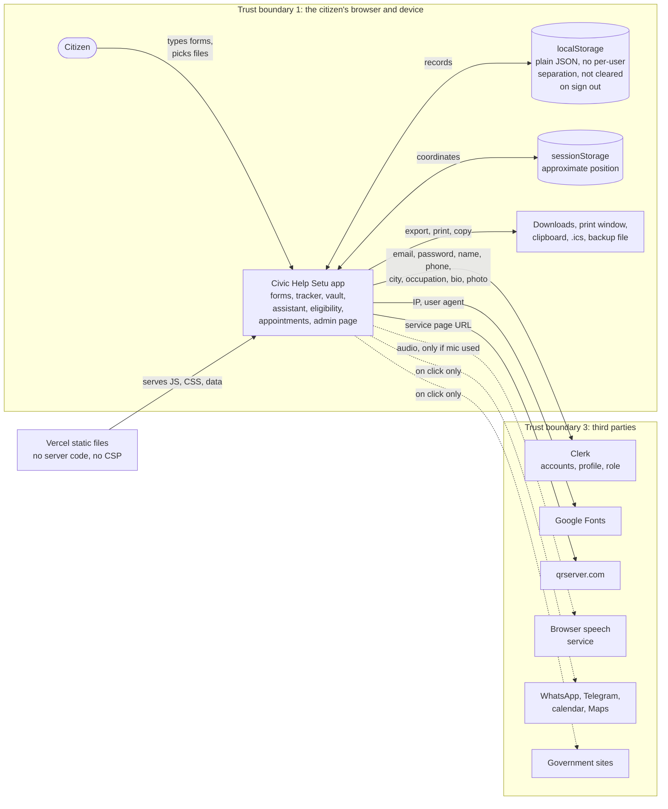

# Citizen data flows and threat model

This is a lightweight threat model for Civic Help Setu. It was written by reading the code on `main` (commit `ee9a8e8`), not from the README or the Privacy page. Where those two disagree with the code, the code wins and the difference is listed under the threats.

Scope: the React app in `src/`, how it is hosted (`vercel.json`), and the third parties it talks to. There is no server of our own in this repo.

How to keep this up to date: when a PR adds a new form field, a new `localStorage` key, a new `fetch` or `` to another site, or a backend, add a row to the inventory below in the same PR.

No secrets and no real citizen data are in this document. Sample values in the code (for example the seed documents in `vaultStorage.js`) are fake and are not repeated here.

## 1. What the app actually is (security-wise)

Facts checked in the source:

- There is **no backend and no database** in this repo. A search of `src/` finds no `fetch`, `axios`, `XMLHttpRequest`, `WebSocket` or `sendBeacon` call. All citizen records live in the browser (`localStorage`, one key in `sessionStorage`).
- There is **no Firebase or Firestore** code or dependency. Issue #220 talks about Firebase rules, so that issue only becomes relevant once a Firestore (or other) backend is added.
- The **Civic Assistant does not call an LLM**. `askGroundedCivicAssistant` and `askCivicAssistant` (`src/ai/`) search the bundled data in `src/data/` in the browser. `VITE_OPENAI_API_KEY` in `.env.example` is not read anywhere in `src/`.
- **Login** is Clerk when `VITE_CLERK_PUBLISHABLE_KEY` is set at build time (`src/main.jsx`, `src/context/AuthContext.jsx`). Without that key the app falls back to a "demo" sign-in that is stored in `localStorage`.
- **No analytics, error tracking or telemetry** package is installed (`package.json`). The "Anonymous Search & Feature Telemetry" consent category in `privacyConsentService.js` has no code behind it.
- There is **no CI** (no `.github/workflows`), no Content Security Policy and no security headers (`vercel.json` only has the SPA rewrite, `index.html` has no CSP meta tag).

Because of the first point, "the server stores X" never happens today. The risks are about the browser, the device, the third parties, and what the UI tells people.

## 2. Data inventory

Sensitivity: **High** means identity or contact data, or free text that people tend to fill with identity data. **Medium** means personal circumstances. **Low** means preferences.

### 2.1 Fields people type in

| Data | Entered in | Stored in | Leaves the browser? | Sensitivity |
|---|---|---|---|---|
| Email, password | Clerk sign-up and sign-in (`SignUp.jsx`, `Login.jsx`) | Clerk (hosted). Not stored by the app | Yes, to Clerk | High |
| Email, display name (demo mode) | `SignUp.jsx`, `Login.jsx` demo form | `civicbridge_demo_user` (localStorage) | No | Medium |
| First name, last name, phone, city, state, occupation, bio | `Profile.jsx` | Clerk (`firstName`, `lastName`, and `unsafeMetadata`: phone, city, state, occupation, bio) | Yes, to Clerk | High |
| Profile photo | `Profile.jsx` avatar upload | Clerk (`setProfileImage`) | Yes, to Clerk | Medium |
| Document type, document number, issuer, issue and expiry date, notes (300 chars max), file name, size and type | Vault (`DocumentModal.jsx`, `vaultStorage.js`) | `civicbridge_vault_docs` | No. Document files are **not** stored, only this metadata | High before #212. Only the last 4 characters of the number are stored now; the notes field is free text and can still hold anything |
| Vault backup file | "Backup" in `VaultBackupRestoreModal.jsx` | A JSON file downloaded to the device | No, but it is a plain-text file in Downloads | High |
| Applicant name, reference ID, service, status, notes, linked documents | Track page, `ManualAddApplicationModal.jsx`, `trackingService.js` | `civicbridge_applications` | No | High |
| Ticked checklist items per application | `Checklist.jsx`, `checklistStorage.js` | `civicbridge_checklists` | No | Low |
| Applicant name, mobile number (last 4 digits only since #212), office, service, date, time slot, token | `AppointmentModal.jsx`, `locationService.js` | `civicbridge_office_tokens` | Only office, date, token and service go into the Google or Outlook calendar link if the user clicks it. Name and number do not | High |
| Citizen name, contact, free-text description, urgency | `GrievanceSubmissionModal.jsx`, `grievanceService.js` | `civic_grievance_tickets` | No. Nothing receives the grievance (see T6) | High |
| Reporter email (optional), description, source URL | `ReportOutdatedInfoModal.jsx`, `reportService.js` | `civicbridge_error_reports` | No | High (email) |
| Name, free-text discrepancy report | Community audit (`communityAuditService.js`) | `civicbridge_community_audits` | No | Medium |
| Name, ratings, review text, tips | `ReviewSubmissionModal.jsx`, `reviewStorage.js` | `civic_service_reviews` | No | Medium |
| Age, annual income, social category (for example SC, ST, OBC, EWS), employment, state, and yes/no answers about documents and land | Eligibility wizards, `assessmentStorage.js` | `civicbridge_eligibility_assessments` | No | High (income and caste category) |
| Applicant name, guardian name, address, PIN code, phone, age, occupation, income, BPL card number, RTI questions | RTI builder (`RtiBuilderModal.jsx`) and the form templates in `civicFormTemplates.js` | In component state only. Printed or copied by the user | No. The letter goes to the print window or clipboard | High |
| Saved services with folder, priority, target date and a free-text note | `savedStorage.js`, `ServiceNoteModal.jsx` | `civicbridge_saved_rich`, `civicbridge_saved` | No | Medium |
| Reminders with a free-text note and deadline | `reminderNotificationService.js` | `civicbridge_reminders`, `civicbridge_notification_settings` | No | Medium |
| Assistant questions and answers | `Assistant.jsx`, `chatStorage.js` | `civicbridge_chat_history` | No | Medium to High (people type their situation) |
| Spoken questions | Mic buttons in `Assistant.jsx` and `VoiceSearchInput.jsx` (browser Web Speech API) | Not stored by the app | **Yes**. Chrome and Edge send the audio to the browser vendor's speech service | Medium |
| Approximate GPS position | `locationService.js` (`navigator.geolocation`, only after the user presses the button) | `civicbridge_user_coords` (sessionStorage) | No. Used to sort offices by distance in the browser | High |
| Denied-location flag | `locationPermission.js` | `civicbridge_location_denied` | No | Low |
| Compared services, FAQ votes, journey progress, offline cache of guides | `comparisonService.js`, `faqService.js`, `journeyDependencyEngine.js`, `offlineCacheService.js` | `civic_compared_services`, `civicbridge_faq_votes`, `civic_journey_progress_<id>`, `civicbridge_offline_cache` | No | Low |
| Theme, language, accessibility settings | `preferencesStorage.js`, `languagePreference.js` | `civicbridge_theme`, `civicbridge_lang`, `civicbridge_plain_lang`, `civicbridge_a11y_prefs`, `civicbridge_focus_mode` | No | Low |
| Consent choices and a privacy audit log | `privacyConsentService.js` | `civicbridge_consent_preferences`, `civicbridge_privacy_audit_log` | No | Low |

Other things worth knowing about the inventory:

- `civicbridge_vault_pin` is listed in the purge list but nothing writes it. There is no vault PIN today.
- `createApplication()` in `trackingService.js` can keep the last four digits of an Aadhaar number, but no component calls it right now. `addManualApplication()` is the one the UI uses and has no Aadhaar field.
- `civicbridge_vault_docs`, `civicbridge_applications`, `civicbridge_error_reports`, the admin queue and a few others are **seeded with sample records** on first load. Sample and real records end up in the same key.
- The admin area (`adminService.js`) keeps its own data in `civicbridge_custom_services`, `civicbridge_error_reports`, `civicbridge_audit_logs`, `civicbridge_rbac_users` and `civicbridge_service_submissions`. These are per browser, not shared.

### 2.2 What the app sends to other companies

| Third party | What they get | When | Where in code |
|---|---|---|---|
| Clerk | Email, password, name, phone, city, state, occupation, bio, photo, sign-in session | Sign-up, sign-in, profile save, and on every page load for the session check when a key is configured | `main.jsx`, `AuthContext.jsx`, `Profile.jsx`, `SSOCallback.jsx` |
| Google (Fonts) | Visitor IP address and user agent | Every page load (`@import` in `src/index.css`) | `src/index.css` line 1 |
| qrserver.com | The URL of the service page in the QR code | When the Share dialog is opened | `QRCodeView.jsx` |
| WhatsApp, Telegram, email app | A text summary of a service guide (public information) | Only when the user clicks the share link | `checklistExportService.js`, `ShareServiceModal.jsx` |
| Google Calendar, Outlook | Office name, address, date, slot, token, service name | Only when the user clicks the calendar link | `calendarExportService.js`, `CalendarSyncModal.jsx` |
| Google Maps | Office or shelter coordinates (not the user position) | Only when the user clicks a directions link | `data/locationOffices.js`, `ReliefShelterFinder.jsx` |
| Browser vendor speech service | Audio of the spoken question | When the mic button is used in Chrome or Edge | `Assistant.jsx`, `VoiceSearchInput.jsx` |
| Vercel (assumed host, from `vercel.json`) | Standard request logs | Every request | not in code |
| Civic data sources | Plain links to government sites (`.gov.in` and similar) that the user opens themselves | On click | `OfficialSourcesList.jsx`, `SourceCard.jsx` |

Nothing from the personal fields in 2.1 is sent anywhere except to Clerk.

## 3. Data-flow diagram

Reading the diagram:

- The only solid arrow carrying personal data off the device goes to Clerk. Dashed arrows only happen when the citizen clicks something.
- Everything that matters for the citizen sits in the same `localStorage` store with no encryption and no per-user separation.
- The admin portal is not a separate system. It is a page in the same app that reads and writes the same browser storage.

### Trust boundaries

1. **Browser and device.** Anything running in the page origin can read all of `localStorage`: our code, any dependency, any browser extension with page access, and any script injected by XSS. Anyone who can use the device can read it too. This is the main boundary, and the app has no control that holds against someone on the same device.
2. **Hosting.** Static files only. If the host or the build is compromised, the attacker controls the code that runs in every citizen's browser. There is no CSP to limit what injected code can do (#219) and no CI checks on dependencies (#222).
3. **Third parties.** Clerk holds accounts. The others only get what the table in 2.2 lists. We do not control their retention.
4. **Not a boundary today:** admin versus citizen. See T2. The role check is a UI check, there is no server to enforce it.

## 4. Retention

| Data | How long it stays | Who deletes it |
|---|---|---|
| Everything in `localStorage` | Until the user clears it or uses "delete my data" in the Privacy Center (`purgeAllUserData`). There is no expiry | The user |
| `civicbridge_user_coords` | Until the tab closes (sessionStorage) | Browser |
| Clerk account data | Until the account is deleted in Clerk | Clerk, on request to the project owner |
| Vault backup and other downloaded files | Until the user deletes the file | The user |
| Vercel request logs | Set by the hosting plan, not by this repo | Host |

Things to be aware of:

- The Privacy Center shows "Max Retention: 14 / 30 / 60 / 90 / 365 days" for each consent category (`CONSENT_CATEGORIES`). Nothing in the code deletes data when those days pass, and no feature checks `isConsentGranted`. The numbers and the toggles are display only today (T10).
- "Delete my data" (`USER_DATA_STORES`) does not remove `civicbridge_checklists`, `civicbridge_community_audits`, `civicbridge_cached_shelters`, `civicbridge_location_denied` or `civicbridge_error_reports`. The last one is on the keep-list on purpose because it doubles as the admin queue, but it also holds the optional reporter email, so that email survives a purge. This belongs in #223.
- Signing out does not clear any citizen data (`logout()` in `AuthContext.jsx` only removes the demo user key).

## 5. Threats

Likelihood and impact are rough: Low, Medium, High. Status is what the code does today.

| ID | Threat | Likelihood | Impact | Status | Remediation |
|---|---|---|---|---|---|
| T1 | XSS through the print windows | Medium | High | Fix open | #227 (fixes issue #204), #219 |
| T2 | Unauthorized access to admin features | High (if a build has no Clerk key) | Medium now, High once a backend exists | Partly mitigated | Proposed F1, F2 |
| T3 | Shared-device exposure | High | High | Partly mitigated | Proposed F3, F4, F5, #223 |
| T4 | Privacy text says data is encrypted, code does not encrypt | High | High | Not mitigated | Proposed F6 |
| T5 | Phishing and unsafe links | Medium | Medium to High | Partly mitigated | Proposed F7, F8 |
| T6 | Abuse and false assurance (grievances and reports go nowhere) | High | Medium | Not mitigated | Proposed F9 |
| T7 | Accidental logging and secret exposure | Low to Medium | Medium | Partly mitigated | #225, #222, Proposed F10 |
| T8 | Third-party data leakage | High | Low to Medium | Partly mitigated | #225, Proposed F11 |
| T9 | Supply chain and missing hardening | Medium | High | Not mitigated | #219, #222 |
| T10 | Consent and retention shown but not enforced | High | Medium | Not mitigated | #223, Proposed F12 |
| T11 | Tampering with local data | Low | Low | Partly mitigated | none needed now |

### T1: XSS through the print windows

- **What:** `RtiPreviewLetter.jsx`, `AppellateEscalationModal.jsx` and `FormTemplatePreview.jsx` build a new window with `document.write` and put the typed letter text into the HTML without escaping it. A pasted `` runs script in a window that is the same origin as the app, so it can read all of `localStorage`.
- **Where it is safe:** the rest of the UI is React text rendering. There is no `dangerouslySetInnerHTML`, `innerHTML` or `eval` in `src/`.
- **Who is at risk:** a person who pastes text from somewhere hostile into the RTI or form fields, then presses Print. It is mostly self-inflicted, but copy-paste from emails and chats makes it realistic.
- **Mitigation:** PR #227 escapes the text (`src/utils/printHtml.js`). It is not merged at the time of writing, so on `main` this is still open. A CSP (#219) would limit the damage of any future XSS.
- **Residual risk after #227:** Low.

### T2: Unauthorized access to admin features

- **What:** `/admin` is wrapped in `<ProtectedRoute requiredRole="admin">`, which checks `user.role` in the browser. With Clerk the role comes from `publicMetadata` only (`roleService.js`), which citizens cannot edit, so that part is right. But:
  - If the app is built **without** a Clerk key, `LocalFallbackAuthProvider` is used, and the login page lets anyone choose the Admin role (`Login.jsx`, `handleDemoSubmit` and `handleQuickDemo`). A production deploy that is missing the env var would silently turn into this.
  - All admin data (services, reports, audit trail, role list) is in `localStorage`. Anyone can edit it with the browser dev tools. Today that only affects their own browser. Once the admin data moves to a shared backend, the same UI check would not protect it.
- **Mitigation today:** the role source for Clerk users is correct. Admin reads and writes are also refused in the data layer for anyone who is not an admin (`src/services/accessControl.js`, inventory in [ACCESS_CONTROL.md](../ACCESS_CONTROL.md)), so the UI is no longer the only check. That still does not stop someone editing `localStorage` by hand. The login page labels demo mode as "Local Demo Authentication Mode", so it is not hidden, but it is still fully usable.
- **Remediation:** proposed F1 (block demo admin in production builds) and F2 (enforce roles on the server when a backend is added). #220: the Firebase rules and emulator tests are in `firebase/` and documented in [FIREBASE_RULES.md](../FIREBASE_RULES.md).

### T3: Shared-device exposure

- **What:** records are stored as plain JSON under fixed key names, not tied to the signed-in user, and are **not cleared on sign-out**. On a shared phone, a family computer or a cyber cafe, the next person in the same browser profile sees the previous person's vault entries, tracked applications, appointments (with phone number), eligibility answers (income, category) and assistant history. The vault `number` field has no masking, and the backup file is plain JSON in Downloads.
- **Mitigation today:** "delete my data" exists in the Privacy Center and purges most keys (`purgeAllUserData`). Chat history can be cleared from the assistant page. Position is only in `sessionStorage`. File contents are never stored.
- **Remediation:** proposed F3 (clear or separate data on sign-out, plus a "shared device" mode), F4 (mask or avoid storing full document numbers), F5 (backup file warning, or a real passphrase encryption), and the key gaps in the purge list under #223.

### T4: Privacy text says data is encrypted, code does not encrypt

- **What:** `Privacy.jsx` says "strict client-side encryption" and "encrypted web storage". The Vault page says "Encrypted Citizen Storage", the stats card says "Encrypted locally", and the backup toast says "Encrypted vault backup downloaded". There is no use of `crypto`, `SubtleCrypto` or any encryption library in `src/`. The `checksum` in the backup is a base64 of the data, not a protection. People are being told it is safe to put sensitive numbers in.
- **Mitigation today:** none.
- **Remediation:** proposed F6 (change the wording to match reality now; add real encryption only as a separate feature).

### T5: Phishing and unsafe links

- **Done well:** the `redirect_url` after sign-in is checked by `sanitizeRedirectPath` (`authRedirect.js`). It rejects other origins, `//host` and `/\` forms, and the auth pages themselves, and it has tests. `SSOCallback.jsx` uses the same check. `reportService.js` and `sourceVerificationService.js` only allow `http:` and `https:`. Outbound links use `rel="noopener noreferrer"`.
- **Gaps:**
  - Several links use a URL straight from data without a check: `ServiceSubmissionReviewModal.jsx` (`submission.officialUrl`), `SourceCitationCard.jsx` (`chunk.sourceUrl`), `VersionHistoryTimeline.jsx`, `JourneyPlannerModal.jsx`. The admin form (`ServiceModal.jsx`) saves whatever URL is typed as an official source and marks it `verified: true`. React 19 blocks `javascript:` URLs in `href`, so the practical risk is a look-alike site, not script.
  - `sourceVerificationService.js` treats `.org.in`, `.ac.in` and `.edu.in` as government domains (`GOV_DOMAIN_PATTERNS`). Anyone can register those, so a "government domain" badge can be shown on a look-alike site.
  - The app itself can be imitated. A fake copy of the sign-in page would collect Clerk credentials. Nothing in this repo can stop that, but the real domain should be stated clearly to users.
- **Remediation:** proposed F7 (one shared safe-URL helper for every external link) and F8 (narrow the government-domain check).

### T6: Abuse and false assurance

- **What:** grievances, outdated-info reports, community audits, reviews and appointments are only saved in the browser that created them. Nobody receives them. The UI wording ("assigned to our civic verification queue", "registered into the redressal queue", "Confirmed" appointment with a token) suggests they were submitted. A citizen who believes a grievance or appointment exists may not follow up elsewhere. That is a real harm even without an attacker.
- **Other abuse cases, for when a backend exists:** spam of reports and reviews, enumeration of reference IDs (IDs such as `SRV-` and `GRV-` numbers come from `Math.random()`, which is fine for display but is not an access token), and filling a free-text field with other people's personal data.
- **Mitigation today:** input length limits on several forms (`vaultValidation.js`, `reportService.js`). No rate limiting is possible without a server.
- **Remediation:** proposed F9 (say plainly on those screens that the record stays on this device).

### T7: Accidental logging and secret exposure

- **What:** there are about 45 `console.error` and `console.warn` calls. Most print only a fixed message and the error object. The ones that can include account details are in `Login.jsx`, `SignUp.jsx` and `Profile.jsx`, where Clerk error objects are logged. Browser consoles are not shipped anywhere (no error-tracking tool is installed), so the exposure is limited to someone with the device or a support screenshot.
- `recordPrivacyAuditLog` removes a fixed list of keys (`email`, `phone`, `aadhaarNumber`, ...). That is a block list, so a new field name slips through. The admin audit trail (`adminService.js`, `details` text) is free text.
- `.env.example` has `VITE_OPENAI_API_KEY=`. Any `VITE_` variable is bundled into the public JavaScript. It is unused now, but it invites someone to paste a real key that would then be visible to every visitor. `.gitignore` already ignores `.env` files and no real keys are committed.
- `sanitizeForPrivacy` in `contextRecommender.js` (redacts Aadhaar, PAN and phone patterns) is defined but not used anywhere, so there is no redaction step before any future model call.
- **Remediation:** #225 (secret exposure review), #222 (CI secret scan), proposed F10 (remove the unused OpenAI variable from `.env.example`, or document that `VITE_` values are public, and wire `sanitizeForPrivacy` in before any model call is added).

### T8: Third-party data leakage

- Every page load asks Google Fonts for CSS and font files, which tells Google the visitor's IP and browser. The QR image request tells qrserver.com which service page was opened. Voice input sends audio to the browser vendor. Clerk gets the account and the profile fields. None of this is mentioned on the Privacy page.
- **Remediation:** #225 for the review, and proposed F11 (self-host the fonts, generate the QR code in the browser, add a plain third-party list to the Privacy page).

### T9: Supply chain and missing hardening

- No CSP and no `X-Content-Type-Options`, `Referrer-Policy`, `X-Frame-Options` or `Permissions-Policy` headers (`vercel.json`). No CI, no dependency or secret scanning.
- **Remediation:** #219 (CSP and headers), #222 (CI checks).

### T10: Consent and retention shown but not enforced

- The consent toggles (chat memory, personalization, offline cache, telemetry) and the retention days are stored and shown, but no feature reads them. A citizen who turns "chat memory" off still has chat saved.
- **Remediation:** #223 (deletion and retention), proposed F12 (make each toggle actually gate its feature, or remove the ones that do nothing).

### T11: Tampering with local data

- A person can edit their own `localStorage`. The services parse with `try/catch`, check types (for example `isValidVaultRecord` on import) and fall back to defaults, so a broken value does not crash the app. This only affects that person. Low risk, listed for completeness.

## 6. Proposed follow ups

These are suggestions for new issues. They are **not filed yet**; the maintainer decides which to open and at what priority. Existing issues are referenced by number instead of being repeated.

| Ref | Proposed title | Covers | Suggested priority |
|---|---|---|---|
| F1 | [security] Do not offer demo sign-in with the admin role in production builds | T2 | High |
| F2 | [security] Define server-side role enforcement before admin data moves off the browser | T2 | Medium (blocks any backend work) |
| F3 | [security] Clear or separate citizen data on sign-out and add a shared-device mode | T3 | High |
| F4 | [security] Mask document numbers in the Vault and avoid storing full numbers by default | T3 | High |
| F5 | [security] Warn on, or encrypt, the Vault backup file | T3 | Medium |
| F6 | [security][docs] Fix the "encrypted" wording on the Privacy page, Vault page and backup dialog | T4 | High (small change) |
| F7 | [security] Add a shared safe-URL helper for all external links | T5 | Medium |
| F8 | [security] Narrow the "government domain" check in sourceVerificationService | T5 | Medium |
| F9 | [security][ux] Say clearly that grievances, reports and appointments are saved only on this device | T6 | High (small change) |
| F10 | [security] Remove or document `VITE_OPENAI_API_KEY`, and use `sanitizeForPrivacy` before any model call | T7 | Low |
| F11 | [privacy] Self-host fonts, generate QR codes locally, list third parties on the Privacy page | T8 | Medium |
| F12 | [privacy] Make consent toggles gate their features and enforce retention periods | T10 | Medium |

Existing issues that already cover part of this:

- #219 Content Security Policy and security headers (T1 damage limit, T9)
- #220 Firebase rules and access-control tests: done as rules written ahead of the backend, see [FIREBASE_RULES.md](../FIREBASE_RULES.md)
- #222 CI security checks for secrets, dependencies and unsafe JavaScript patterns (T7, T9)
- #223 Privacy-safe deletion and retention controls (T3, T10; include the keys listed in section 4)
- #225 Third-party integration review for data minimization and secret exposure (T7, T8)
- #227 (pull request for #204) Escape user text in the print windows (T1)

## 7. Not covered

- The Clerk dashboard settings (allowed redirect URLs, password rules, session length, which sign-in methods are on). These are configuration outside the repo.
- The Vercel project settings and who has access to it.
- A real penetration test. This is a code read.
- Any backend, because there is none yet. Redo this model when one is added.
